<p align="center">
  <picture>
    <source media="(prefers-color-scheme: dark)" srcset="docs/logo-full.svg">
    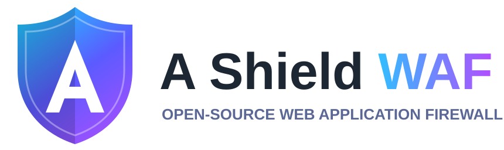
  </picture>
</p>

# A Shield WAF

An open-source **web application firewall with a web GUI**, built for Kubernetes and for the cloud. It combines proven free components
into one product:

- **Engine:** nginx + **ModSecurity v3** + the **OWASP Core Rule Set**, with TLS termination and an anti-bot challenge.
- **Control panel (GUI):** HTTPS-only web app: sites, TLS certificates, maintenance switch, page editor, login gate, rate limits,
  IP lists, auto-ban, attack log, dashboard, two-factor login, audit trail, backup, Prometheus metrics.
- **Highly available:** two or more identical replicas (pods) behind one Service, all sharing one PostgreSQL database; a replica can crash,
  restart or be replaced and nothing is lost. Each replica is two hardened containers (non-root, read-only filesystem, no capabilities,
  network policy). About 250 MB RAM per replica with four sites.
- **Fast reloads:** the OWASP rules are loaded once and shared by all sites, so 80 sites reload in a few seconds instead of minutes.

**Free and open source** (Apache-2.0), for Kubernetes (tested on kind) and the cloud. No secrets are stored in this repo: the database
password is generated in your cluster and the admin account is created in your browser on first start.

> **Provided as is, without warranty, and not independently audited.** It is built on proven components and tested with 192 automated
> checks, but it has not been reviewed or certified by an outside party. Read **[How secure is it?](SECURITY.md#how-secure-is-it-the-honest-summary)**
> and the limits below before using it in production, and commission an independent test for high-value systems.

## Documentation

| Read this | When |
|---|---|
| [`docs/INSTALL.md`](docs/INSTALL.md) | step-by-step installation (kind, any Kubernetes, first login) |
| [`docs/USER-GUIDE.md`](docs/USER-GUIDE.md) | every screen and setting, with examples |
| [`docs/TROUBLESHOOTING.md`](docs/TROUBLESHOOTING.md) | something does not work |
| [`docs/CLOUD.md`](docs/CLOUD.md) | running in the cloud (registry, load balancer, cert-manager, managed PostgreSQL) |
| [`docs/DDOS.md`](docs/DDOS.md) | denial-of-service defence: what it does, what must sit in front |
| [`SECURITY.md`](SECURITY.md) | security design, honest assessment, limits, how to report a vulnerability |
| [`docs/SECURITY-REVIEW.md`](docs/SECURITY-REVIEW.md) | scans, scanner baseline, findings and fixes |
| [`COMPARISON.md`](COMPARISON.md) | comparison with SafeLine and BunkerWeb |
| [`CONTRIBUTING.md`](CONTRIBUTING.md), [`tests/README.md`](tests/README.md) | helping, and running the test suite |

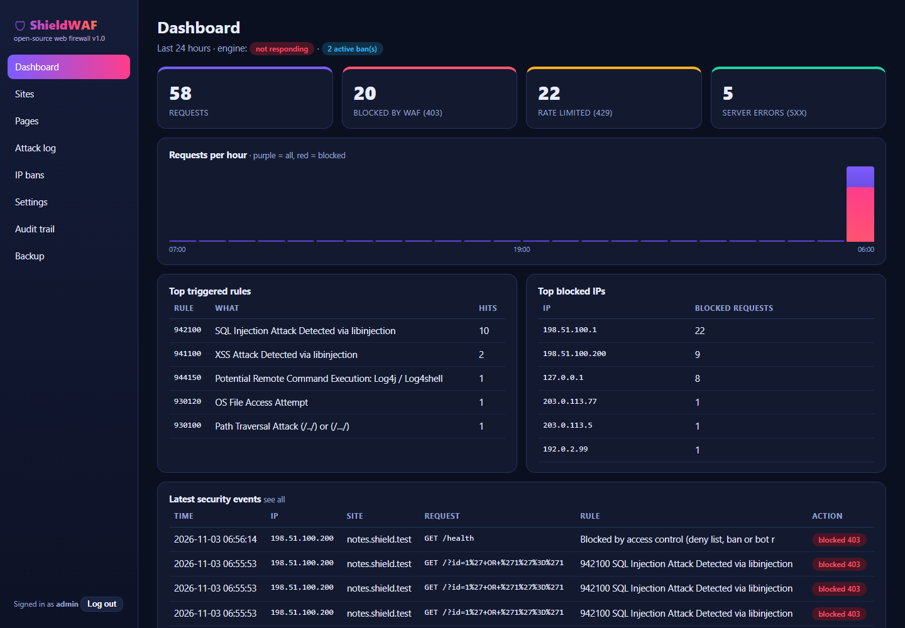
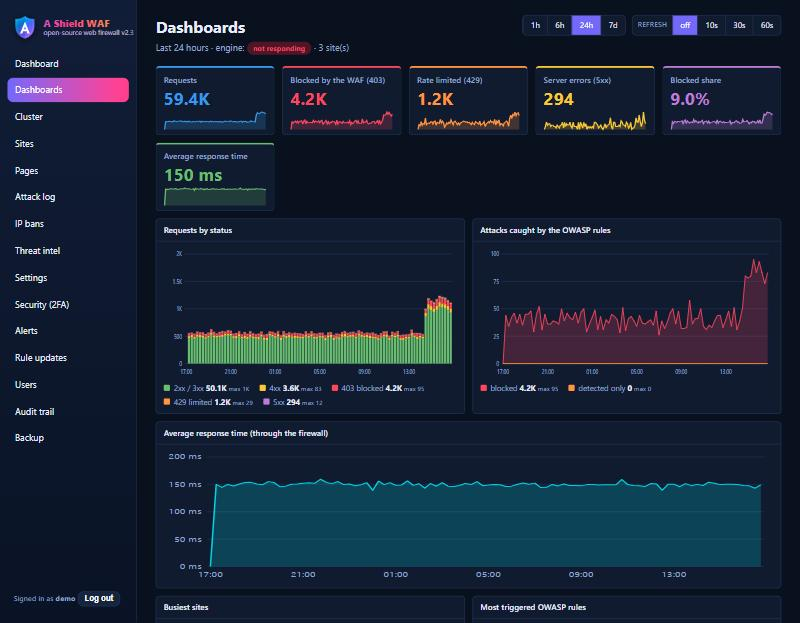

## Features

| Area | What you get |
|---|---|
| **Attack blocking** | OWASP CRS 4: SQL injection, XSS, path traversal, file inclusion, command injection, Log4Shell, scanner detection, protocol attacks; JSON bodies inspected |
| **Per-site WAF mode** | `block`, `detect only` (log, never block: ideal for tuning) or `off`; paranoia level 1-4, anomaly threshold |
| **False-positive tuning** | rule exclusions (global or per URL path), custom ModSecurity rules |
| **TLS / HTTPS** | TLS 1.2/1.3 only, certificate upload, self-signed generation, **mounted cert-manager secrets**, **automatic free certificates (Let's Encrypt / any ACME authority) with renewal 30 days before expiry**, HSTS, HTTP to HTTPS redirect, HTTP/2 |
| **Anti-bot challenge** | proof-of-work page for browsers; signed pass bound to client IP + browser; scope "pages" or "all"; path exclusions |
| **Login gate** | require user name + password in front of any site (users managed in the GUI, hashes only) |
| **Several upstreams per site** | spread a site over up to 10 backends: weights, "backup" servers, keep-a-visitor-on-one-backend mode, automatic retry of read requests on the next backend, and **active health checks** that take a failed backend out of rotation and bring it back |
| **Maintenance mode** | one-click switch per site or all sites; the app keeps running; colourful editable page |
| **Automatic service-down page** | friendly page when the app is unreachable; reloads itself and the app returns by itself |
| **Positive security model** | per site: only the listed paths, content types and URL length are accepted; everything else is refused, whatever it contains (not pattern based) |
| **IP reputation feeds** | Spamhaus DROP + FireHOL level 1 (or your own https lists), refreshed automatically; private/reserved ranges never loaded |
| **Country rules** | per site allow/deny by registered country (free regional-registry data, no licence key) |
| **Flood defence** | one-click **under-attack mode** (challenge for everyone + rate limit) and **automatic escalation** when a site exceeds a request-rate threshold ([`docs/DDOS.md`](docs/DDOS.md)) |
| **Alerts + SIEM export** | webhooks (Slack, Teams, Discord, generic), email, syslog (RFC 5424 JSON / CEF), HTTP collector (Splunk HEC, Elastic); alerts for engine down, attack spikes, auto-bans, under-attack, lockouts, admin changes, certificate expiry; every blocked request can be forwarded to your SIEM; secrets never shown again |
| **OWASP rule updates** | new releases detected and staged automatically, tried in **detect-only canary** sites, then promoted with one click, with rollback; nothing goes live without approval |
| **OpenAPI validation** | upload your OpenAPI 3 document: unknown paths / methods / parameters / JSON fields, missing required fields, wrong types, enums, ranges and lengths are refused (or logged in detect mode) |
| **High availability** | 2+ replicas, shared sessions, changes applied on every replica (the confirmation says "applied on 3/3 replicas"), one leader for once-only jobs with automatic failover, encrypted file sharing through the database, rolling updates without dropped requests, **Cluster** page ([`docs/INSTALL.md`](docs/INSTALL.md#high-availability)) |
| **Fast reloads** | one shared OWASP rule set instead of one per site: 80 sites apply in about 6 seconds; `nginx -t` takes about 0.2 s |
| **PostgreSQL** | configuration, attack log, sessions and audit trail live in PostgreSQL (in-cluster, hardened) or in your managed PostgreSQL |
| **Users and roles** | several administrators and read-only **viewers**; forced password change for new users; reset 2FA / revoke sessions |
| **Rate limiting, IP control** | per-IP rate limit, per-site allow/deny lists, manual bans, **auto-ban** (like fail2ban), method allow-list |
| **Hardening** | unknown hosts get no reply, no server version, strict timeouts/header limits, real client IP only from trusted proxies, security headers |
| **Cloud safety** | upstream SSRF protection (no loopback / cloud-metadata targets), optional allowed-suffix list for upstreams |
| **Admin security** | HTTPS only, **TOTP two-factor login** + recovery codes, lockouts, revocable sessions with idle timeout, CSRF, strict CSP, panel IP allow-list, audit trail with IPs |
| **Visibility** | dashboard, searchable attack log with OWASP rule ids, Prometheus `/metrics` (bearer token), and **Grafana-style Dashboards** built into the panel (time ranges, charts, top sites / rules / addresses, replicas) |
| **Safe operations** | every change is tested (`nginx -t`) and confirmed live before it counts; automatic rollback; config export/import (re-validated, no secrets) |

## Quick start

Full instructions with explanations: [`docs/INSTALL.md`](docs/INSTALL.md). The short version:

```bash
# 0. create the database secret (random password, kept only in the cluster, never in git)
sh scripts/create-db-secret.sh            # Windows: .\scripts\create-db-secret.ps1

# 1. build the image and load it into kind (for a real cluster push it to your registry, see docs/CLOUD.md)
docker build -t shieldwaf:2.3 .
docker build -t shieldwaf-db:16 db
kind load docker-image shieldwaf:2.3 shieldwaf-db:16 --name mycluster

# 2. deploy
kubectl apply -f k8s/shieldwaf.yaml
kubectl get pods -n shieldwaf                  # two shieldwaf-... pods at 2/2 and shieldwaf-db-0 at 1/1
```

### First start: create the admin account
```bash
kubectl port-forward -n shieldwaf svc/shieldwaf-panel 9000:9000
kubectl logs -n shieldwaf deploy/shieldwaf -c panel          # find the line "Setup code: ..."
```
Open **https://localhost:9000** (the certificate is self-signed at first: accept the warning, or mount your own),
enter the setup code, then **choose your own admin name and a strong password**. Then open **Security (2FA)** and enable two-factor login.

### Protect an application (Sites, then + Add site)
Enter the public host name and the address of your application inside the cluster, for example host `app.example.com`, upstream
`http://my-app.my-namespace.svc.cluster.local:80`. Start in **detect only** mode, watch the attack log, then switch to **block**.

### Reach the protected apps
```bash
kubectl port-forward -n shieldwaf svc/shieldwaf-proxy 8088:8080 8443:8443
```
Add `127.0.0.1  app.example.com` to your hosts file (Administrator) and open `http://app.example.com:8088`.
For other PCs add `--address 0.0.0.0` and open the firewall port. In the cloud use a LoadBalancer service (see `docs/CLOUD.md`).

## The GUI

| Screen | Use |
|---|---|
| **Dashboards** | **Grafana-style dashboards**: time range (1 h, 6 h, 24 h, 7 d) and auto-refresh, stat tiles with sparklines, requests by status, attacks caught, response time, busiest sites, most triggered OWASP rules, top blocked addresses, replicas |
| **Dashboard** | requests, blocks, rate limits, 5xx, hourly chart, top rules and IPs, warnings (2FA off, certificate expiring) |
| **Cluster** | the replicas, which one is leader, whether each has applied the newest configuration, and how long the last reload took |
| **Sites** | add/edit/delete; **TLS, anti-bot, login gate, methods, rate limit, WAF tuning**; **Maintenance ON/OFF** per site or for all |
| **Pages** | edit the maintenance and service-down pages with live preview |
| **Attack log** | filter by site, text, blocked / detected; OWASP rule id and score |
| **IP bans** | manual and automatic bans |
| **Threat intel** | reputation feeds, country data, address lookup |
| **Users** | administrators and viewers (admin only) |
| **Alerts** | channels, which events alert, SIEM export, delivery log (admin) |
| **Rule updates** | stage, canary-test, promote and roll back OWASP rule sets (admin) |
| **Settings** | panel allow-list, idle timeout, upstream restrictions, flood defence, auto-ban, trusted proxies, metrics token, password |
| **Security (2FA)** | enable/disable two-factor login |
| **Audit trail** | who did what, from which IP |
| **Backup** | export/import sites, settings and pages |

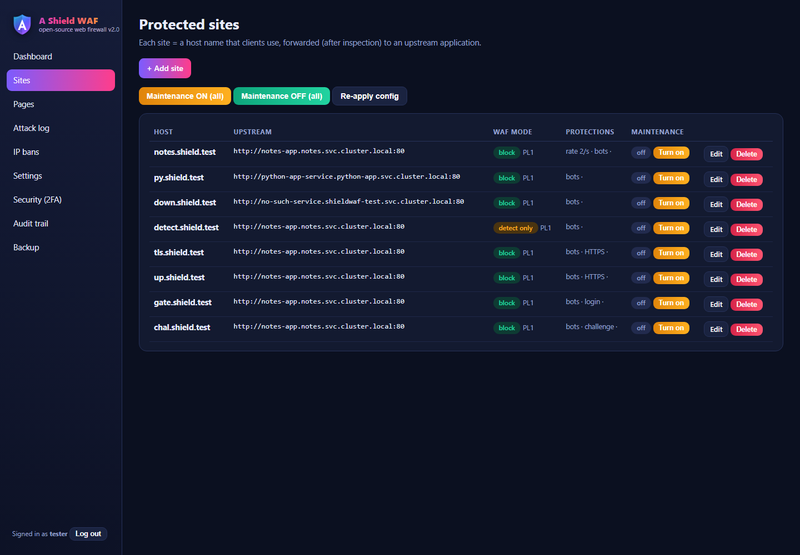
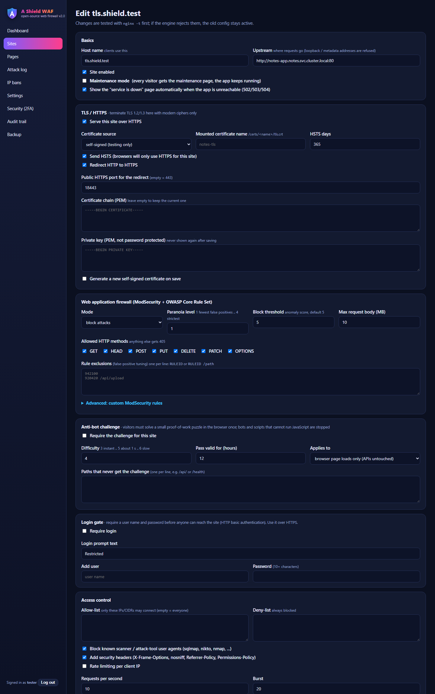
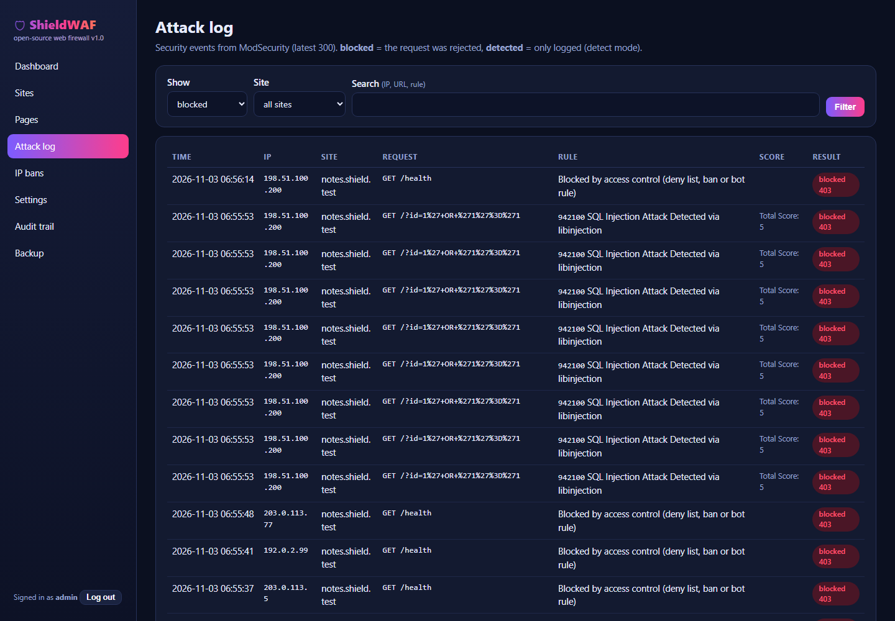
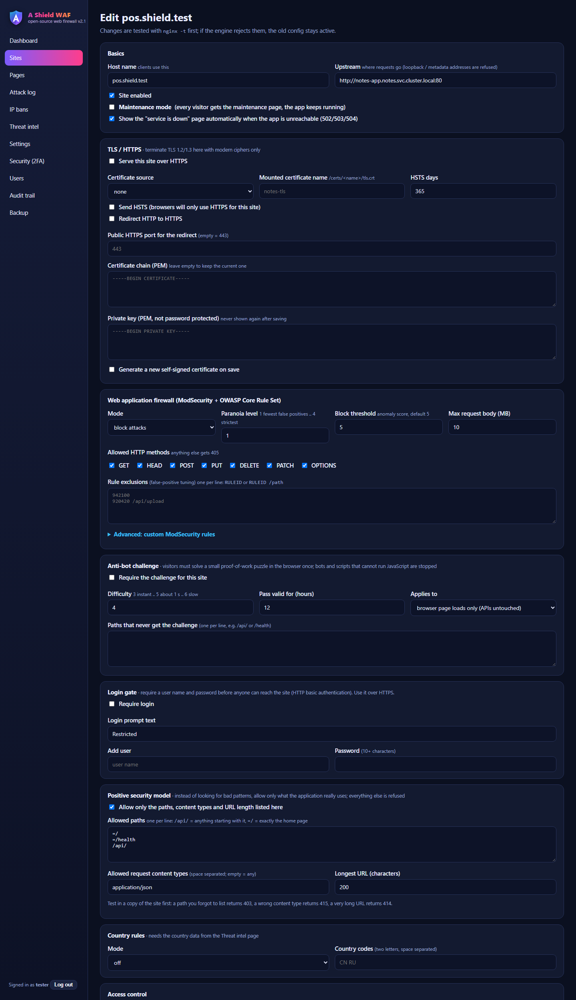
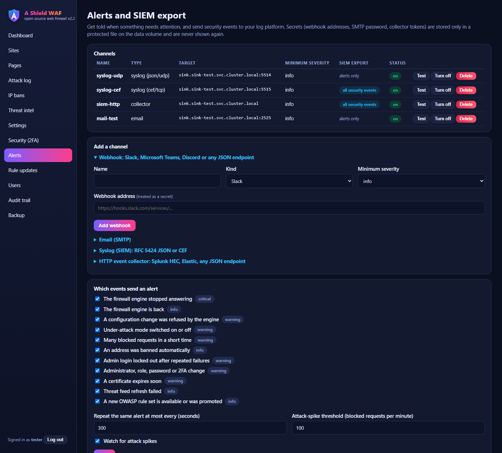
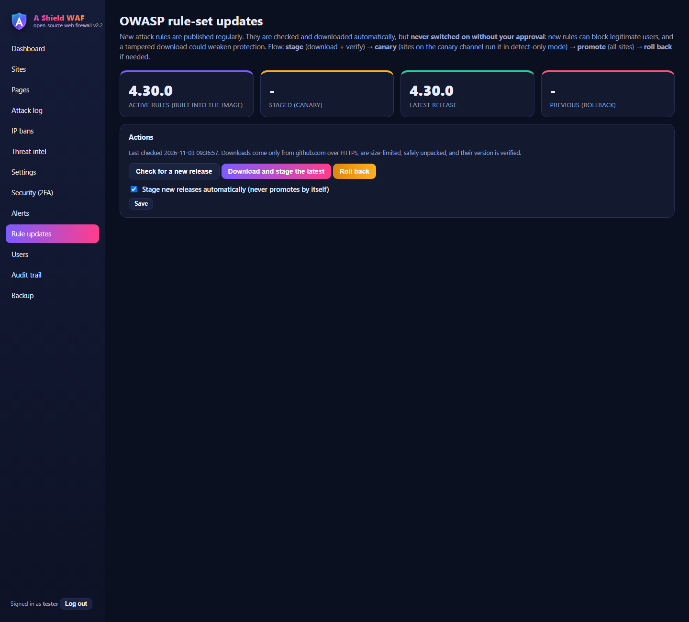
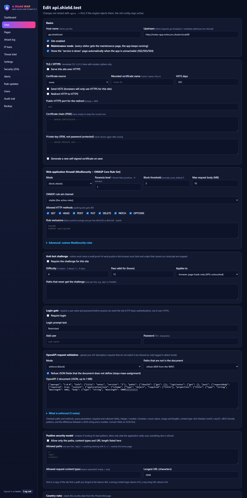
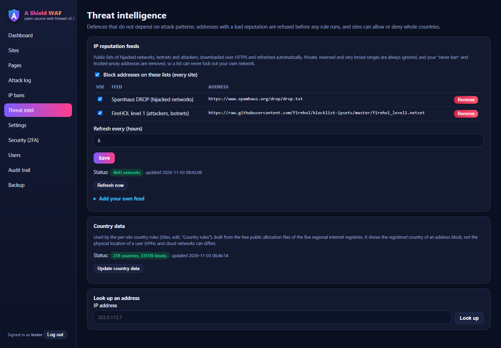
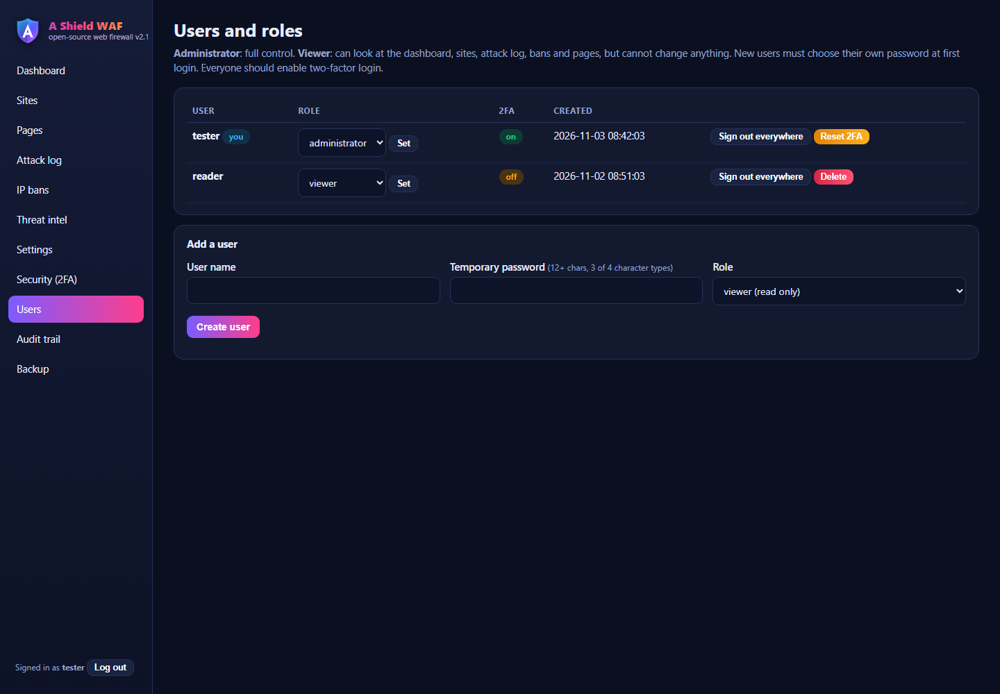
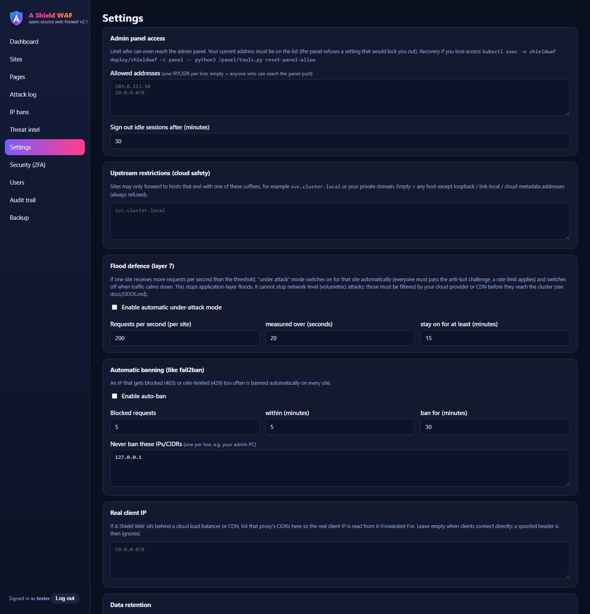
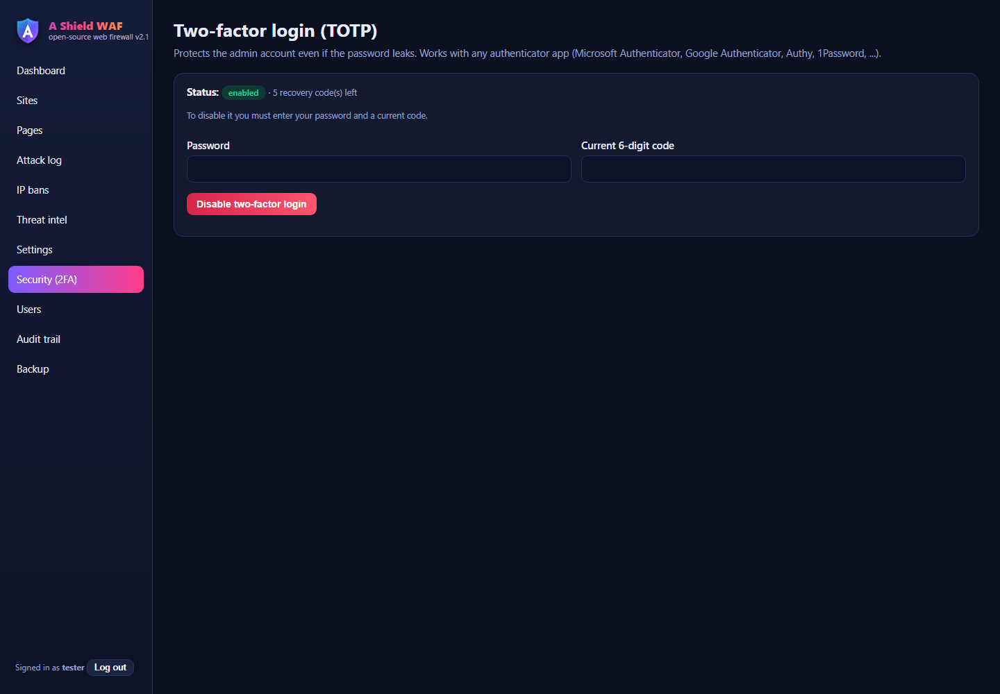
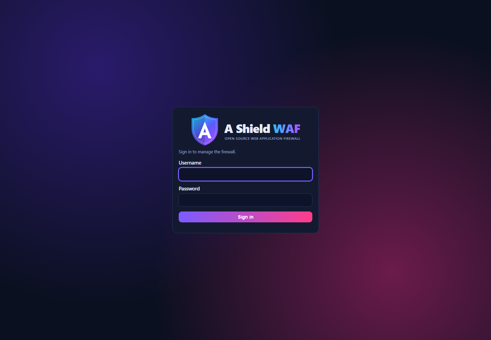

## How it works

```
 client --Host: app.example.com--> [engine: nginx + ModSecurity + OWASP CRS (+ TLS, challenge)] --> your application
                                          ^ reload, confirmed by a handshake file
                                   [panel: renders nginx + rule files into /data/rendered/gen-N, tests them, swaps "current"]
                                          | tails access.log / audit.json into PostgreSQL -> dashboard, attack log, auto-ban
```
With two or more replicas every replica runs this whole picture by itself and they all read the same PostgreSQL:

```
 clients -> Service -> [replica 1: engine + panel] --\
                       [replica 2: engine + panel] ---+--> PostgreSQL (configuration, sessions, logs, encrypted shared files)
                       [replica 3: engine + panel] --/
```
A change saved on any replica is applied by all of them within about a second. Certificates, keys and downloaded rule sets travel through the
database **encrypted** with a key that exists only in a cluster secret. One replica at a time is the leader and runs the jobs that must happen once.
The two containers share only the `/data` volume: the panel writes a new generation and a `reload.request`; the engine tests and
reloads nginx, waits until the new generation answers, and reports in `reload.status`. If it fails the panel restores the previous generation.

## Test results (kind, two demo applications as upstreams)
The suite is in [`tests/`](tests/README.md) and you can run it yourself (`bash tests/run.sh`, needs a test cluster, 15-25 minutes).
An automated suite of **192 checks** (all passing on the final build, run on **two replicas** of a real cluster with a real PostgreSQL) plus **91 high-availability checks** (three replicas) covers: setup and password policy, wrong-code and weak-password refusal, login lockout, TOTP login with
recovery codes and replay refusal, session revocation after logout and after a password change, CSP/HSTS/cookie flags, metrics token,
panel allow-list lock-out protection, SSRF refusal (loopback, metadata address and names, allowed-suffix list), import validation,
13 attack types blocked, unknown-host drop, header-size and method limits, spoofed `X-Forwarded-For`, TLS (1.1 refused, 1.3 works,
unknown-host handshake refused, HSTS, redirect), certificate upload (mismatched key refused, key never shown), login gate, anti-bot
challenge (correct work, wrong work, forged seed, forged cookie, other browser, scope pages/all, exclusions), maintenance, service-down
page, rate limiting, auto-ban, backup contents and audit trail, the positive security model, live reputation feeds, country rules (real address blocks), under-attack mode and its automatic escalation under a real flood, and the admin / viewer roles, alert delivery through every channel type to a test receiver (webhook, syslog UDP/TCP, CEF, HTTP collector with a secret header, SMTP), SIEM forwarding of a blocked attack, OpenAPI enforcement (missing / unknown / over-long fields, undocumented methods and paths), the complete OWASP rule-set cycle with a **real GitHub download** (check, stage, canary in detect-only, promote, rollback), and persistence in PostgreSQL across a panel restart. A separate Pebble test (`tests/acme.sh`) exercises the certificate client in isolation. The high-availability suite checks: shared sessions, keys and certificates, a change on one replica served by all, twelve administrators on three replicas at once with nothing lost, 80 sites applied in seconds with correct per-site behaviour (detect-only, thresholds, paranoia levels, exclusions, own rules, wildcards), killing the leader (new leader in about 10 s, no failed requests), a replacement replica catching up by itself, a **database outage** (the firewall keeps serving), and a **rolling restart under load with zero failed requests**. Static analysis (Bandit), manifest and image scans (Trivy: 0 high/critical) and an OWASP ZAP baseline (0 failures) are in [`docs/SECURITY-REVIEW.md`](docs/SECURITY-REVIEW.md). See [`SECURITY.md`](SECURITY.md) for the design and the limits.

## Limits (honest list)
- **No independent audit.** A documented self-review is in [`docs/SECURITY-REVIEW.md`](docs/SECURITY-REVIEW.md); get a third-party test before relying on it for high-value systems.
- **Detection is partly pattern-based** (OWASP rules). The positive model, reputation feeds, country rules, challenge and flood defence add protection that does not depend on patterns, but keep your applications patched.
- **No volumetric DDoS protection** (impossible inside a cluster); application-layer floods are handled; see [`docs/DDOS.md`](docs/DDOS.md) for what to put in front.
- **The database is the one single point of failure.** The replicas keep serving traffic when it is down (tested), but you cannot change the configuration until it is back, and a replica that is *newly started* during an outage cannot start. For real redundancy use a managed, replicated PostgreSQL (see `docs/CLOUD.md`).
- Rate limits and the per-address connection cap are counted **per replica** (each replica sees only its own share of the traffic), so with N replicas an address can use up to N times the limit. Plan the numbers accordingly.
- Reload time is now almost independent of the number of sites, except while an OWASP rule-set update is being canary-tested (two rule-set versions cannot be shared): then each site loads its own copy again and reloads are slower; test canaries on few sites.
- Load balancing is simple: a request is sent to a randomly chosen (weighted) healthy backend. There is no connection reuse tuning, no slow-start and no session replication; health checks are done by one replica (the leader) and take about 20 seconds to react.
- Automatic certificates use the HTTP-01 check, so they need a public host name that reaches the firewall on port 80, and no wildcard names (those need a DNS check, not built in; use cert-manager for wildcards). The ACME client is tested against Pebble, the official test server; it was not run against the real Let's Encrypt here because that needs a public domain.
Details in `SECURITY.md`.

## Comparison with SafeLine and BunkerWeb
See [`COMPARISON.md`](COMPARISON.md).

## Licence
[Apache License 2.0](LICENSE): free to use, change and share, including commercially, with no warranty. Third-party components keep their
own licences, see [`THIRD_PARTY_NOTICES.md`](THIRD_PARTY_NOTICES.md). Bug reports and pull requests are welcome ([`CONTRIBUTING.md`](CONTRIBUTING.md));
report security problems privately as described in [`SECURITY.md`](SECURITY.md).

## Files
| Path | Purpose |
|---|---|
| `Dockerfile`, `engine-entrypoint.sh`, `panel-entrypoint.sh` | the single image: engine and panel |
| `panel/cluster.py`, `panel/sharedfs.py` | high availability: leader election, change propagation, encrypted shared files |
| `tests/` | the 192-check regression suite, the 91-check high-availability suite and their runner |
| `panel/` | control panel (Flask app, renderer, security helpers, workers, templates, anti-bot challenge in `njs/`) |
| `k8s/shieldwaf.yaml` | hardened namespace, replicated Deployment, disruption budget, PostgreSQL StatefulSet, services, network policies |
| `db/Dockerfile` | the PostgreSQL image (official, pinned, OS fixes, unused `gosu` removed) |
| `scripts/create-db-secret.*` | creates the database secret in the cluster (random password) |
| `SECURITY.md` | security design, limits, operator duties |
| `docs/SECURITY-REVIEW.md` | self-review: scans, scanner baseline, findings and fixes |
| `docs/CLOUD.md` | running it in the cloud |
| `docs/DDOS.md` | denial-of-service defence: what the WAF does, what must sit in front |
| `.github/workflows/security.yml` | CI: Bandit, Trivy (config + image), hadolint |
| `docs/` | logo and GUI screenshots |
