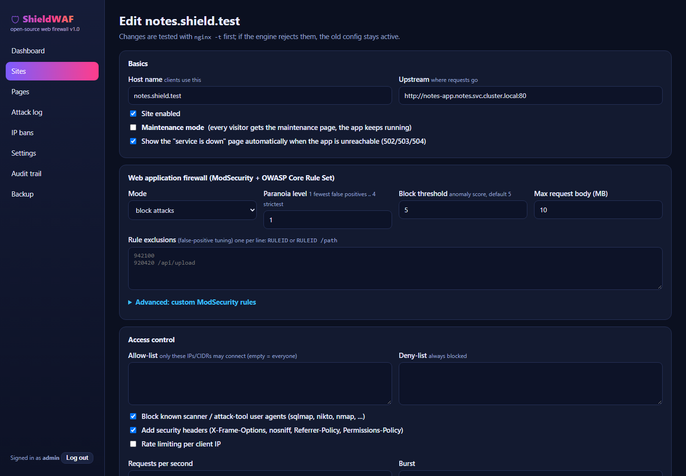
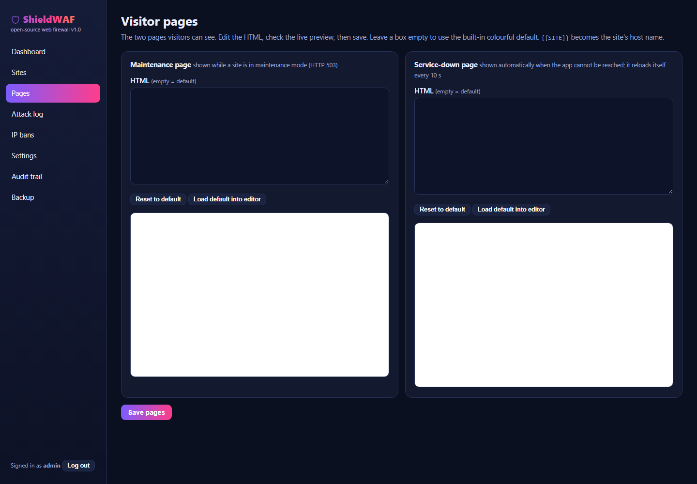

# ShieldWAF: an open-source web firewall with a GUI, for Kubernetes

ShieldWAF combines proven free components into one product with one web GUI:

- **Engine:** nginx + **ModSecurity v3** + the **OWASP Core Rule Set** (the rules used by most commercial WAFs).
- **Control panel (GUI):** a small Python (Flask) web app: sites, per-site maintenance switch, page editor, rate limits,
  IP lists, auto-ban, attack log, dashboard, audit trail, backup, Prometheus metrics.
- **Runs as one pod, two containers** (engine + panel) sharing a small volume. About **230 MB RAM** with four sites loaded.

Everything is free and open source. Built and tested on the kind cluster `mycluster`. No secrets are stored in this repo: the admin account is created in the browser on first start.


## Features (all tested: 50 of 50 automated checks passed)

| Area | What you get |
|---|---|
| **Attack blocking** | OWASP CRS v4: SQL injection, XSS, path traversal, file inclusion, command injection, Log4Shell, scanner detection, protocol attacks. Attacks inside JSON POST bodies are inspected too. |
| **Per-site WAF mode** | `block`, `detect only` (log, never block: best for tuning a new app) or `off` |
| **Tuning** | paranoia level 1-4, anomaly threshold, **rule exclusions** (global or per URL path) for false positives, custom ModSecurity rules |
| **Maintenance mode** | **one-click switch per site** (or all sites). Visitors get a colourful 503 page, the app keeps running. |
| **Automatic service-down page** | if the app is unreachable (502/503/504) visitors see a friendly page that **reloads itself every 10 s**; the real app returns by itself. |
| **Page editor** | edit both visitor pages in the GUI with live preview; per-site overrides; `{{SITE}}` placeholder |
| **Rate limiting** | per client IP, requests/second + burst (HTTP 429) |
| **IP control** | per-site allow-list and deny-list (IPs/CIDRs), global manual bans with expiry |
| **Auto-ban (like fail2ban)** | an IP blocked too often is banned on every site for N minutes; never-ban list |
| **Bot / scanner blocking** | known attack-tool user agents (sqlmap, nikto, nmap, nuclei, ...) |
| **Security headers** | X-Frame-Options, nosniff, Referrer-Policy, Permissions-Policy |
| **Visibility** | dashboard (requests per hour, blocked, top rules, top IPs), searchable attack log with OWASP rule ids, **Prometheus `/metrics`** |
| **Admin safety** | first-run setup with one-time code, hashed password, CSRF protection, login throttling, audit trail, config **export/import** |
| **Safe changes** | every change is tested with `nginx -t` **before** it is applied; if the engine rejects it, the old config stays active and the GUI shows the error |
| **Real client IP** | trusted-proxy list so `X-Forwarded-For` is honoured only from proxies you name |

### Not included (honest list)
- **TLS termination / automatic certificates**: the lab runs plain HTTP. Put cert-manager or an ingress with TLS in front (planned next).
- Country blocking (needs a GeoIP database), CrowdSec community blocklists, Grafana dashboards: planned for phase 2.
- No volumetric DDoS protection (that needs a network provider or CDN in front), no machine-learning detection.
- Single admin account, single replica (no high availability yet).
- ModSecurity itself ignores an unknown rule *operator* in custom rules (syntax errors and duplicate ids are rejected).

## Install

```bash
# 1. build the image and load it into kind (no registry needed)
docker build -t shieldwaf:1.0 .
kind load docker-image shieldwaf:1.0 --name mycluster

# 2. deploy
kubectl apply -f k8s/shieldwaf.yaml
kubectl get pods -n shieldwaf                  # 2/2 Running
```

### First start: create the admin account
```bash
kubectl port-forward -n shieldwaf svc/shieldwaf-panel 9000:9000
kubectl logs -n shieldwaf deploy/shieldwaf -c panel | findstr "Setup code"      # PowerShell / cmd; use grep on Linux
```
Open **http://localhost:9000**, enter the setup code from the log, then **choose your own admin username and a password of at least 12 characters**.

### Add the two apps (Sites, then + Add site)
| Host name | Upstream |
|---|---|
| `notes.waf.local` | `http://notes-app.notes.svc.cluster.local:80` |
| `python.waf.local` | `http://python-app-service.python-app.svc.cluster.local:80` |

Keep the defaults (mode `block`, paranoia 1) and press **Save and apply**.

### Reach the protected apps
```bash
kubectl port-forward -n shieldwaf svc/shieldwaf-proxy 8088:8080
```
Add `127.0.0.1  notes.waf.local  python.waf.local` to your hosts file (Administrator), then open `http://notes.waf.local:8088`.
Test with curl: `curl -H "Host: notes.waf.local" http://127.0.0.1:8088/`. For other PCs add `--address 0.0.0.0` and open the firewall port.

## Using the GUI

| Screen | Use |
|---|---|
| **Dashboard** | requests, blocks, rate limits, 5xx, hourly chart, top rules and IPs, latest events |
| **Sites** | add/edit/delete sites, **Maintenance ON/OFF** per site or for all |
| **Pages** | edit the maintenance and service-down pages with live preview |
| **Attack log** | filter by site, text, blocked / detected; shows the OWASP rule id and score |
| **IP bans** | manual and automatic bans |
| **Settings** | auto-ban rules, trusted proxies, retention, change password |
| **Audit trail** | who changed what |
| **Backup** | export/import sites + settings + pages as JSON (never the password or bans) |






## How it works

```
 client --Host: notes.waf.local--> [engine: nginx + ModSecurity + OWASP CRS] --> notes-app / python-app-service
                                        ^  SIGHUP reload after `nginx -t` passes
                                 [panel: renders nginx + rule files into /data/rendered/gen-N, swaps the "current" link]
                                        |  tails access.log / audit.json into SQLite -> dashboard, attack log, auto-ban
```
- Config lives in `/data/config.json` (volume); logs and stats in `/data/shield.db`. Old rendered generations are kept (last 5) so a bad change can never take the engine down.
- `shareProcessNamespace: true` lets the panel find the nginx master process and send the reload signal.

## Test results (2026-11-03, kind, notes app + python app as upstreams)
Automated suite (`50/50` passed): setup/login/CSRF, site validation, normal traffic, SQLi, XSS, file inclusion, command injection,
Log4Shell, scanner UA, JSON-body attack, detect mode, unknown host, automatic service-down page, maintenance on/off (one site, all sites,
custom page), rate limiting (429), deny list, allow list, manual ban/unban, auto-ban (and other IPs unaffected), attack log, dashboard,
Prometheus metrics, backup export without secrets, audit trail.

## Security notes
- The panel is a ClusterIP service: reach it with `kubectl port-forward` (localhost only) unless you deliberately expose it.
- Use a strong password; it is stored only as a salted hash. Anyone who reaches the panel before setup needs the one-time setup code from the pod log.
- `/metrics` has no login (counts only); keep the panel service internal.

## Comparison with SafeLine and BunkerWeb
See [`COMPARISON.md`](COMPARISON.md).

## Files
| Path | Purpose |
|---|---|
| `Dockerfile`, `engine-entrypoint.sh` | one image for engine + panel |
| `panel/` | the control panel (Flask app, renderer, background workers, templates) |
| `k8s/shieldwaf.yaml` | namespace, volume, pod, services |
| `docs/images/` | GUI screenshots |
